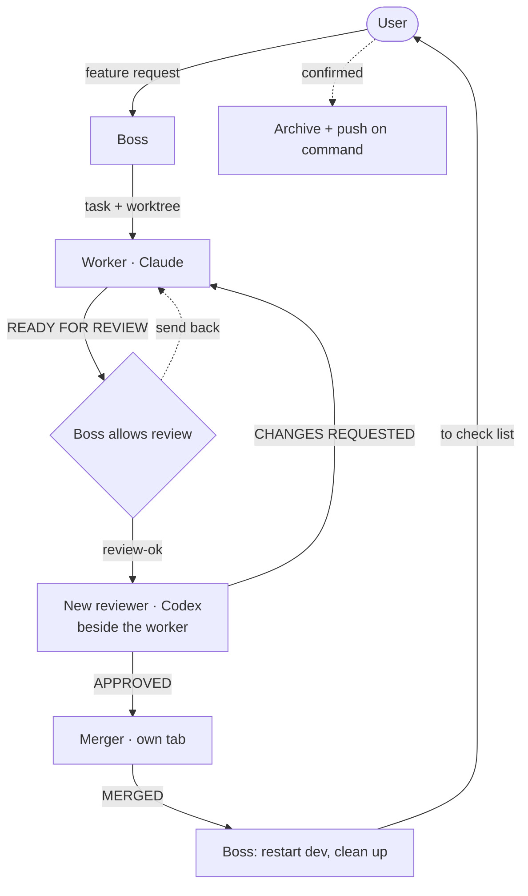

<p align="center"></p>

# leha-loop

A Claude Code skill that makes the agent a "feature boss" for any git project. It runs a team of agents in [Herdr](https://herdr.app) (`hc`, herdr-core):

- Claude workers, each in its own git worktree and its own app space;
- a new Codex reviewer for every review, opened by the worker in a pane beside it, once the boss allows the review;
- a merger in the main checkout, in its own tab, that merges approved work and archives or pushes only on command;
- watching the agents, cleaning up worktrees, restarting the dev server.



It fits projects that use [OpenSpec](https://github.com/Fission-AI/OpenSpec): branch = worktree = change id, the boss gives each worker its own change (a shared plan, if any, stays with the boss), workers apply it, reviewers run `openspec validate --strict`. Merged but unarchived changes become the user's "to check" list, and a change is archived only after the user confirms it. Projects without OpenSpec work too, with plain branches.

## Install

```sh
git clone https://github.com/alexzomai/leha-loop ~/.claude/skills/leha-loop
```

Requires `hc` (herdr-core), `claude`, `codex`, `git`, `jq` and Python 3.

Works on macOS (the system bash 3.2 is enough) and Linux. Without `lsof` (some Linux systems) cleanup only warns about a worker's dev server still holding its port instead of stopping it.

## Getting started in a project

In a Claude Code session inside Herdr app, in the project folder, say "you are the feature boss" (or run `/leha-loop`). The boss runs `scripts/status.sh`, creates the project config `~/.config/leha-loop/<project>.env` from `config.example.env`, and then `scripts/team-up.sh` starts the team.

Project rules for all agents live in `~/.config/leha-loop/<project>.notes.md`. General role rules live in `roles/`.

Details are in [SKILL.md](SKILL.md).
