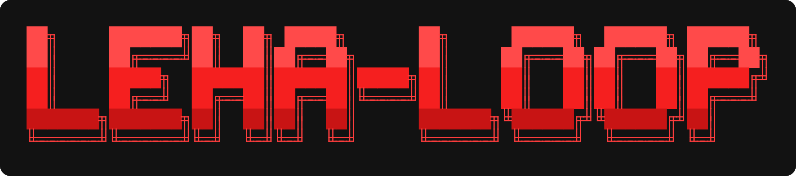
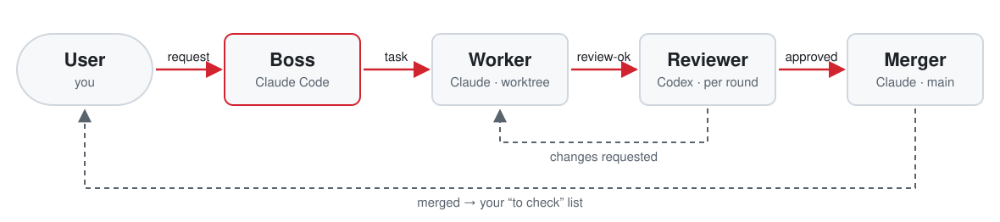

<p align="center">
  
</p>

<p align="center">
  <b>Turn one Claude Code session into a feature boss that runs a whole team of coding agents.</b><br>
  Parallel Claude workers in isolated worktrees, a fresh Codex reviewer for every review, a dedicated merger, all in one Herdr window.
</p>

<p align="center">
  <a href="https://docs.anthropic.com/en/docs/claude-code/skills"></a>
  <a href="https://herdr.app"></a>
  <a href="https://github.com/Fission-AI/OpenSpec"></a>
  
  
  <a href="LICENSE"></a>
</p>

<p align="center">
  <a href="#how-it-works">How it works</a> ·
  <a href="#install">Install</a> ·
  <a href="#quick-start">Quick start</a> ·
  <a href="#configuration">Configuration</a> ·
  <a href="#scripts">Scripts</a> ·
  <a href="#faq">FAQ</a> ·
  <a href="SKILL.md">Full playbook</a>
</p>

---

## Why

One agent in one checkout is a bottleneck: it works on one thing at a time, reviews its own code and needs you to merge. leha-loop splits that job into roles, the way a real team does:

- **You** talk only to the boss: what to build, and whether the result is right.
- **The boss** plans, hands out tasks, gates reviews and merges. It never writes product code.
- **Workers** build features in parallel, each in its own branch, worktree, port and app space.
- **Reviewers** are a different model (Codex), started fresh for every round, so they have no stake in the code.
- **The merger** is the only agent that touches the main branch.

Every handoff is checked by a script, not by trust: a review only runs for the exact commit the boss allowed, and a merge only happens when the verdict matches the branch's current HEAD.

## Features

- **Parallel workers.** `mkworker.sh` creates a worktree, copies gitignored files (`node_modules`, `.env.local`), runs setup, assigns a free port and opens the worker in its own Herdr space.
- **Cross-model review.** Each review gets a new Codex reviewer in a pane beside the worker. The worker reads the verdict and fixes findings itself.
- **Commit-pinned verdicts.** `verdict.sh` returns `APPROVED`, `STALE` (the base changed the same files) or `NONE`, and `merge.sh` refuses anything but `APPROVED` for the current HEAD.
- **Bounded review loops.** After `MAX_REVIEW_ROUNDS` the boss stops and asks you instead of looping forever.
- **Self-healing babysitting.** `babysit-hc.sh` waits for an agent's turn to end, resumes dropped API connections, waits out usage limits and flags agents blocked on a prompt.
- **Safe cleanup.** `cleanup-worker.sh` runs every check before deleting anything and refuses unmerged branches or dirty worktrees.
- **Survives restarts.** Branch state (worker, port, reviewer, reviewed SHA, round, phase) lives in `state.json`; `status.sh` rebuilds the picture after a crash or context compaction.
- **OpenSpec-native.** One change per worker, reviewers run `openspec validate --strict`, and merged but unarchived changes become your "to check" list.
- **You keep the keys.** Push, archive and anything destructive happen only on your explicit command.

## How it works

<picture>
  <source media="(prefers-color-scheme: dark)" srcset="assets/loop-dark.svg">
  
</picture>

| Role | Agent | Where it runs | Lifetime |
| --- | --- | --- | --- |
| Boss | Claude Code (your session) | main checkout | the whole session |
| Worker | Claude | own worktree, own app space, own port | one branch |
| Reviewer | Codex | pane right of its worker | one review round |
| Merger | Claude | main checkout, `MERGE_TAB` tab | standing, context reset before each merge |
| Dev server | `DEV_CMD` | `DEV_TAB` tab | standing, restarted after each merge |

With [OpenSpec](https://github.com/Fission-AI/OpenSpec), branch = worktree = change id. The boss creates each worker's change in the main checkout before the worktree exists; a shared multi-worker plan stays with the boss. Projects without OpenSpec work too, with plain branches.

## Install

```sh
git clone https://github.com/alexzomai/leha-loop ~/.claude/skills/leha-loop
```

### Requirements

| Tool | Used for |
| --- | --- |
| [Herdr](https://herdr.app) with `hc` (herdr-core) | terminals, panes, spaces |
| [`claude`](https://docs.anthropic.com/en/docs/claude-code) | boss, workers, merger |
| [`codex`](https://github.com/openai/codex) | reviewers |
| `git`, `jq`, Python 3 | worktrees, state, layout |
| `lsof` *(optional)* | stopping a worker's dev server on cleanup |
| [`openspec`](https://github.com/Fission-AI/OpenSpec) *(optional)* | specs and the "to check" list |

Runs on macOS (the system bash 3.2 is enough) and Linux. Without `lsof`, cleanup warns about a port still in use instead of stopping the process.

## Quick start

1. Open the project folder in a Claude Code session inside the Herdr app.
2. Say **"you are the feature boss"** or run `/leha-loop`.
3. The boss runs `status.sh`, writes `~/.config/leha-loop/<project>.env` from [`config.example.env`](config.example.env) (asking only what it can't find in your repo), offers to set up OpenSpec, and starts the merger and dev server with `team-up.sh`.
4. Ask for a feature:

   > Add CSV export to the reports page.

   The boss names the branch, writes the task, starts a worker and reports back when the work is merged and ready for you to check at `DEV_URL`.

## Configuration

Each project has one config at `~/.config/leha-loop/<repo-folder>.env`. It is bash and gets executed, so it is never read from the repository. The main keys:

| Key | Example | Meaning |
| --- | --- | --- |
| `REPO_PATH` | `/path/to/repo` | repository this config belongs to |
| `BASE` | `main` | branch to merge into |
| `PREFIX` | `myproj-` | terminal name prefix |
| `WORKER_CMD` | `(claude --model claude-opus-5-5 --permission-mode auto)` | how workers start |
| `MERGER_CMD` | same shape | how the merger starts |
| `REVIEWER_CMD` / `REVIEWER_MODEL` | `(codex …)` / `latest-sol` | how reviewers start |
| `MAX_REVIEW_ROUNDS` | `3` | rounds before the boss asks you |
| `DEV_CMD` / `DEV_PORT` / `DEV_URL` | `(npm run dev -- -p 3000)` | main dev server |
| `WORKER_PORTS` | `3100-3199` | port range for workers |
| `COPY` / `WT_SETUP` | `(node_modules .env.local)` | how a new worktree is prepared |

See [`config.example.env`](config.example.env) for every option, including proxy setup.

Rules for every agent in one project go in `~/.config/leha-loop/<project>.notes.md`. Rules for every project live in [`roles/`](roles).

## Scripts

All scripts live in `scripts/` and find the project from the current git folder.

| Script | Who runs it | What it does |
| --- | --- | --- |
| `status.sh` | boss | config, terminals, branches in work, worktrees, unmerged branches, OpenSpec changes |
| `team-up.sh` | boss | starts the merger and dev server; safe to rerun |
| `mkworker.sh <branch> <name> <task>` | boss | worktree + port + worker in its own space |
| `babysit-hc.sh <name>` | boss | waits for an agent's turn, recovers from drops, detects blocks |
| `send.sh <name> <text>` | boss | messages an agent so babysit waits for the reply |
| `review-ok.sh <branch>` | boss | allows a review of exactly the current HEAD |
| `review.sh` | worker | starts a fresh Codex reviewer beside itself |
| `verdict.sh <branch>` | boss | `APPROVED` / `STALE` / `NONE` for the current HEAD |
| `merge.sh <branch>` | boss | hands an approved branch to the merger |
| `restart-dev.sh` | boss | restarts the dev server in place |
| `cleanup-worker.sh <branch> <name>` | boss | removes worker, reviewer, space, worktree and branch |
| `layout.py` | scripts | reads and edits the Herdr app layout, with backups |

## Guardrails

- The boss never writes product code, switches the main checkout or merges.
- Agents never start other agents, except a worker starting its own reviewer after `review-ok.sh`.
- Secrets (`.env*`, keys) are never printed, committed or retold.
- Other people's terminals, processes, ports and spaces are left alone.
- Push, OpenSpec archiving, deleting data and touching external systems need your explicit command.

## FAQ

<details>
<summary><b>Why Codex for review instead of another Claude?</b></summary>

A different model catches different mistakes, and a fresh reviewer per round has no memory of defending earlier code. Change `REVIEWER_CMD` if you want something else.
</details>

<details>
<summary><b>Do I need OpenSpec?</b></summary>

No. Without it, workers use plain branches and reviewers check the diff and run the project's tests, linter and build without a spec. The boss offers OpenSpec once and remembers if you decline.
</details>

<details>
<summary><b>What happens if the session crashes or the context is compacted?</b></summary>

Nothing is lost. Run `status.sh`: branch phases, ports, reviewers and reviewed SHAs are in `~/.cache/leha-loop/<project>/state.json`. A crashed merger or dev server is recreated by `team-up.sh` in its old place in the layout.
</details>

<details>
<summary><b>Can I run it on two repos with the same folder name?</b></summary>

Yes. Set `FB_PROJ` to give one of them a different project name.
</details>

<details>
<summary><b>Windows?</b></summary>

Not supported. macOS and Linux only.
</details>

## Project layout

```text
leha-loop/
├── SKILL.md              # the boss playbook Claude Code loads
├── config.example.env    # per-project config template
├── roles/                # rule templates: worker, reviewer, review task, merger
└── scripts/              # status, team-up, mkworker, review, verdict, merge, cleanup, …
```

Working files (tasks, `state.json`, review reports, setup logs, layout backups) go to `~/.cache/leha-loop/<project>/`.

## License

[MIT](LICENSE)
